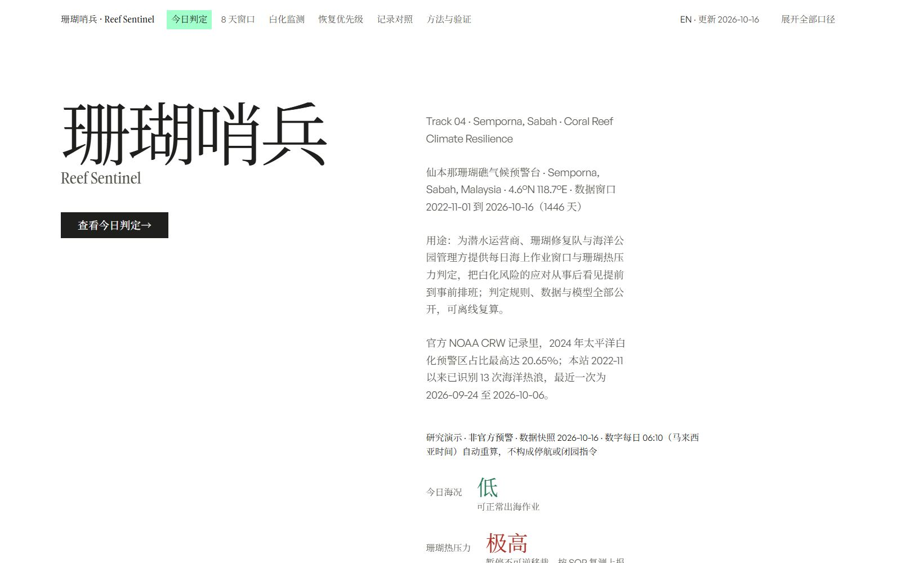
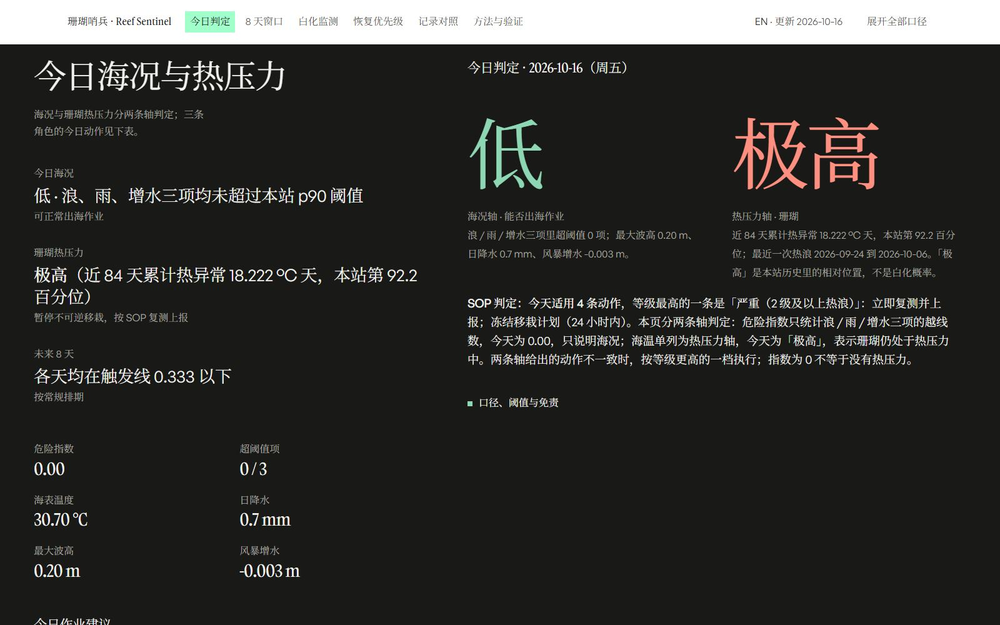

# Reef Sentinel (珊瑚哨兵)

**A coral-reef climate early-warning page for Semporna, Sabah, Malaysia** — entry for the AI4Climate Global Youth Climate Solutions Challenge, Track 04 (*Semporna, Sabah — Coral Reef Climate Resilience*).

> This is the English edition of [README.md](README.md). The product interface itself is in Chinese; the page carries an **English summary block** (`Summary for international reviewers`) one click away from the `EN` item in its top bar — the link targets the block itself and the page's small inline script opens it for you, so you do not have to hunt through collapsed sections. `EN` is a navigation item (not the small print next to the date), so it is still there on a phone. The same summary is printed at the end of the submitted Project statement.



- **Live page (rebuilt daily):** <https://sloilmarve.github.io/reef-sentinel/> — GitHub Actions refetches the data and republishes every day at 06:10 Malaysian time.
- **Repository:** <https://github.com/sloilmarve/reef-sentinel>
- **Offline copy:** [demo/index.html](demo/index.html) — one self-contained file, double-click to open; no server, no network, no JavaScript required to read the numbers.
- **Demo video (3 min, Chinese narration with bilingual Chinese–English burned-in subtitles):** submitted separately on the challenge platform; script and storyboard in [docs/04_演示视频逐字稿与分镜.md](docs/04_演示视频逐字稿与分镜.md).

## The problem

Semporna's reefs support dive tourism, reef-restoration teams and more than a thousand households. Three climate-driven hazards decide whether a day is workable and whether corals are under acute stress: **swell, storm-water runoff, and storm surge** — plus **sea-surface temperature**. Today the signals exist but are scattered across regional products that answer the wrong question for a dive operator at 06:00: *is today workable, which of the next eight days should I avoid, when may I schedule irreversible restoration work, and is heat stress heading toward bleaching?*

## What we built

One reproducible pipeline that turns fully public ocean and weather data into a single offline page answering exactly those four questions.

- **Compound hazard index (0–1)** combining three drivers against the station's own record-period p90 thresholds; sea-temperature stress is tracked as a separate axis, never mixed into the index.
- **Ridge regression, 1–14 day horizon**, 66 features (rolling statistics, hazard memory, seasonality, same-day raw levels). No scikit-learn: the closed-form solution is hand-written, and the runtime dependency list is `numpy==2.2.6` plus the standard library. The shrinkage strength λ is chosen by cross-validation *inside each training window*, never touching the test segment.
- **Calibrated uncertainty**: the page's 80% interval is an empirical interval taken from out-of-sample residuals (1.18–1.28 × RMSE), not a nominal Gaussian band.
- **Local bleaching watch**: 31-day rolling seasonal climatology with Hobday et al. (2016/2018) marine-heatwave definitions, 13 events so far; levels are quantiles of the station's own record.
- **Protection priority and intervention windows** for three sites (Semporna, Bunaken, Palau) under one set of definitions, with thresholds rebuilt from each site's own record.
- **A 7-step trigger-response SOP**: what each of three roles should do at each level, with re-survey dates and work windows computed from the data.
- **One static HTML page**: everything — three SVG figures, a 300-day strip, 7 CC-licensed photographs and the embedded official NOAA regional map — is pre-rendered in Python. A single inline script only adds progressive enhancement (scroll reveal, day-tab readout, expand-all, nav highlighting). Disable JavaScript and every number is still readable.



## Results (out-of-sample, expanding-window cross-validation)

| Horizon | Model RMSE | Persistence | Climatology | Constant mean | Ranking AUC (model / persistence) | RMSE vs persistence |
|---|---|---|---|---|---|---|
| 1 day | **0.1406** | 0.1776 | 0.2057 | 0.1644 | **0.796 / 0.585** | **20.8%** |
| 3 days | **0.1603** | 0.1935 | 0.2056 | 0.1637 | **0.665 / 0.438** | **17.2%** |
| 7 days | **0.1624** | 0.1919 | 0.2045 | 0.1635 | **0.600 / 0.437** | **15.4%** |
| 14 days | **0.1615** | 0.1772 | 0.2028 | 0.1638 | **0.615 / 0.583** | **8.9%** |

What the table does **not** say, stated plainly:

- The index is zero on **72.3%** of days, so "always predict the training mean" is a very hard baseline. At 3 / 7 / 14 days the model beats it by 0.0035 / 0.0011 / 0.0024 — **noise level**. Only the 1-day advantage is real (20.8% over persistence, 14.5% over the constant mean).
- The AUC above uses the label *"at least one driver crosses its threshold on day h"* (27.7% positive out-of-sample). Under the stricter two-driver compound-hazard label, 7-day AUC is **0.569 vs 0.426** for persistence (`data/processed/compound_label_audit.json`).
- **Binary disaster warning failed**: 7-day out-of-sample AUC **0.495** (≈ random), and it loses to persistence at 3 / 7 / 14 days. The product therefore ships no classifier.
- Cross-site transfer wins **11 of 12** site × horizon AUC cells (the exception is Semporna at 14 days: 0.580 vs 0.584) — reported as measured, not cherry-picked.
- The learned bleaching component (`pipeline/bleach_forecast.py`, logistic regression, 4-fold expanding window) reaches PR-AUC **0.364** against **0.311** for the current rule and **0.242** base rate. Fold 3 goes the other way (rule 1.000, model 0.499), and today the rule reads "extreme" while the model says 0.202 for the next four weeks — they answer different questions, and both are shown.

## Data

- Open-Meteo Marine + ERA5 archive, **2022-11-01 to 2026-10-16, 1,446 days**, all public and free, refreshed by one command.
- Thresholds are **the station's own percentile** (wave p90 = 0.40 m, rain p90 = 15.6 mm, surge p90 = 0.033 m, daily-mean SST p90 = 30.667 °C), so the method transfers to another site by rebuilding them there.
- **Official cross-check**: NOAA Coral Reef Watch 5 km v3.1 public summary (1985-03-25 to 2026-10-13, 15,178 days) plus the Coral Triangle hazard map are embedded in the page. NOAA's record also ranks **2024** as the worst year (Pacific bleaching-alert area peaking at 20.65%), matching this station's worst year by compound-hazard days.
- **Station-level comparison**: NOAA CRW's virtual station *Sabah, Malaysia* overlaps 1,410 days; all 13 local marine heatwaves fall inside official alert periods (but the station is in alert 82.3% of the time, so the lift is only 1.21× — the check proves there were no misses, not that it discriminates). Mean SST differs from the official pixel SST by **0.013 °C (r = 0.717)**; Palau repeats the check at 0.061 °C / r = 0.921. Official DHW on 2026-10-15 is 14.20 (Alert Level 2) while our stricter baseline yields 0 — the discrepancy and its cause are documented rather than hidden.
- Official NetCDF point time series are not reachable from this environment; the fetch command is kept in `data/external/FETCH_NOAA_CRW.sh` and the limitation is disclosed in the materials.

## Reproduce

```powershell
# Python 3.10 + numpy==2.2.6; no sklearn, no matplotlib.
$py = "python"

# Full chain (same as double-clicking 更新数据.bat): refetch -> features -> model -> baselines
# -> forecast drivers -> interval calibration -> page payload -> NOAA panels -> bleaching watch
# -> priority plan -> the page itself -> full verification.  Measured 37 s to 143 s on this machine (upstream API latency dominates).
& $py pipeline\refresh.py          # ends with REFRESH OK

# Materials and submission checks
& $py tools\consistency_audit.py   # RESULT ALL CONSISTENT
& $py tools\preflight.py           # 6 offline steps (Word + consistency + pack + self-check + settlers + offline repro); PREFLIGHT ALL PASS
& $py tools\reviewer_repro.py      # unpack the submission zip, re-run 7 steps offline,
                                   # and byte-compare the rebuilt page with the packed one
```

`tools/reviewer_repro.py` is the claim that matters for review: the submitted archive is self-sufficient — a third party can rebuild the page it contains, byte for byte, without network access. The clean-clone rehearsal (only tracked files, no local tooling) rebuilt the same page SHA-256 prefix `48c06a6ff72de2ec` — that is the build pushed live in round 44. The live page is since rebuilt by the scheduled job every day with the same generator and fresher data, so its bytes change daily (measured 2026-10-18: 2,129,776 bytes, SHA-256 prefix 8669af8f6b30067e, data snapshot 2026-10-17 — the older layout with newer data, while this archive carries the newer layout on a frozen snapshot). Read the data-snapshot date in the live page's footer to see which build is live; do not compare it against the hash recorded here — and it runs the same 25-step refresh in 37 seconds (other runs of the same chain took 143 s and 145 s; upstream API response time dominates).

Line endings are pinned by `.gitattributes` (`* text=auto eol=lf`, with `.bat` kept CRLF): many artefacts here are compared byte for byte, so a checkout must not depend on the machine's Git settings. Git for Windows ships with `core.autocrlf=true`; without the pin, a fresh clone hands you a `demo/index.html` carrying 535 CR characters — the recorded SHA-256 would no longer match and `tools/consistency_audit.py` would report a failure on a perfectly good checkout. That audit recomputes the current page's SHA-256 prefix on every run and compares it with the value written in `README.md`, so a stale hash fails loudly instead of passing silently. A rehearsal with that default setting confirms the page still checks out as pure LF and the audit passes without rebuilding.

## Submission materials (five, per the challenge rules)

| Requirement | Where it is |
|---|---|
| ① Project statement | [docs/01_项目说明.md](docs/01_项目说明.md) (+ English summary) |
| ② Demo video (≤ 3 min) | `珊瑚哨兵-Reef-Sentinel-演示视频.mp4` (176.5 s), uploaded separately; storyboard in docs/04 |
| ③ Working output | [demo/index.html](demo/index.html), the live page, and this repository |
| ④ Data & AI statement | [docs/02_数据与AI说明.md](docs/02_数据与AI说明.md) |
| ⑤ Validation plan | [docs/03_90天验证计划.md](docs/03_90天验证计划.md) |

Supporting documents: [docs/04](docs/04_演示视频逐字稿与分镜.md) (video script), [docs/05](docs/05_报名表与提交清单.md) (registration and checklist), [docs/06](docs/06_作品帖与发布草稿.md) (public post drafts).

## Honesty and boundaries

1. **This is a research demo, not an official warning.** Decisions to suspend diving or close a site must follow the Malaysian Meteorological Department (MetMalaysia) and Sabah Parks.
2. Standard NOAA DHW (MMM + 1 °C) is **identically zero** here, for a baseline reason: the official long-term MMM is 29.4999 °C while a three-year record can only supply 30.517 °C. The index is therefore a *relative* heat-pressure measure, not evidence of zero bleaching risk.
3. Forecasts are driven by numerical weather prediction for 8 days only; beyond that they are not meaningful. The drivers' own error is quantified separately (replacing the target-day driver with persistence raises 1-day RMSE by 9.9% and cuts ranking AUC by 0.085).
4. Adding a new reef site costs one line of coordinates, but the site's thresholds and baselines must always be rebuilt from its own record.
5. Data ethics: the page collects nothing (no forms, cookies, analytics or third-party requests — verified by an automated interaction test), and the 90-day validation plan includes written consent, role-only attribution and a 12-month retention limit before any partner is interviewed.

## License

Code and documents: **MIT** ([LICENSE](LICENSE)). Derived data, figures and the built page: **CC BY 4.0**, credited to "珊瑚哨兵 / Reef Sentinel". Upstream data: Open-Meteo (CC BY 4.0), ERA5 (Copernicus), NOAA Coral Reef Watch (public domain). Photographs are CC BY / CC BY-SA from Wikimedia Commons, credited individually in the page footer and in item 4 of the additional notes in [LICENSE](LICENSE).
